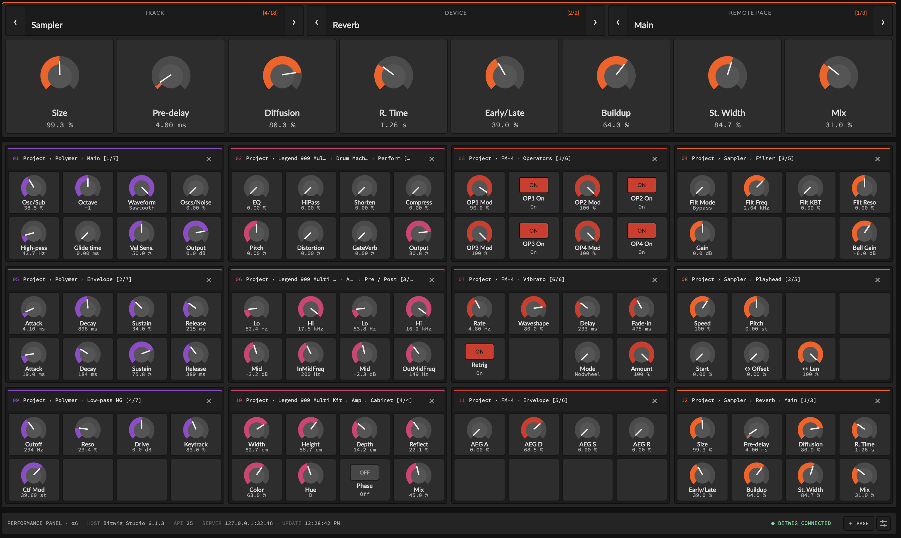

# Performance Panel

A project-aware browser surface for Bitwig Studio Remote Controls, pinned pages,
mixer channels, and transport.



Performance Panel follows the active Bitwig project and uses its existing track
names, colors, hierarchy, Remote Controls, and controller mappings. The Bitwig
extension serves the panel locally; there is no companion process, account, or
internet connection at runtime.

The Navigator switches between the selected device's Remote Controls and
project-wide Project Remotes. Device pages can be pinned below for persistent
access while either source is active.

## Install

1. Download `PerformancePanel.bwextension` from the
   [Releases page](https://github.com/chardstew/bitwig-performance-panel/releases).
2. Drag the file onto an open Bitwig Studio window.
3. In **Settings → Controllers**, add **CHXRD → Performance Panel**.
4. Open <http://127.0.0.1:32146> in Chrome.

If drag installation is unavailable, copy the file to the Bitwig Studio
`Extensions` directory for your operating system, restart Bitwig, and continue
from step 3.

The [User Guide](https://chardstew.com/bitwig-performance-panel) covers
navigation, pinned pages, layout, hotkeys, and connection troubleshooting.
Installing the page as a Chrome app is recommended for a dedicated window
without browser toolbars.

## Development

Requirements: JDK 21, Node.js 20, `curl`, and `zip`.

```sh
./scripts/test.sh
```

See [CONTRIBUTING.md](CONTRIBUTING.md), the current
[architecture](docs/architecture.md), and [protocol v1](protocol/v1.md).

Current development testing is on macOS with Bitwig Studio 6.1.3 and Chrome.
Windows and Linux reports are welcome.

## Scope

Performance Panel is alpha software built only on Bitwig's public Extension API.
It does not process audio. Device-modulator enumeration is not currently exposed
by the public API and is not simulated.

Independent community software; not affiliated with or endorsed by Bitwig GmbH.
Released under the [MIT License](LICENSE).
